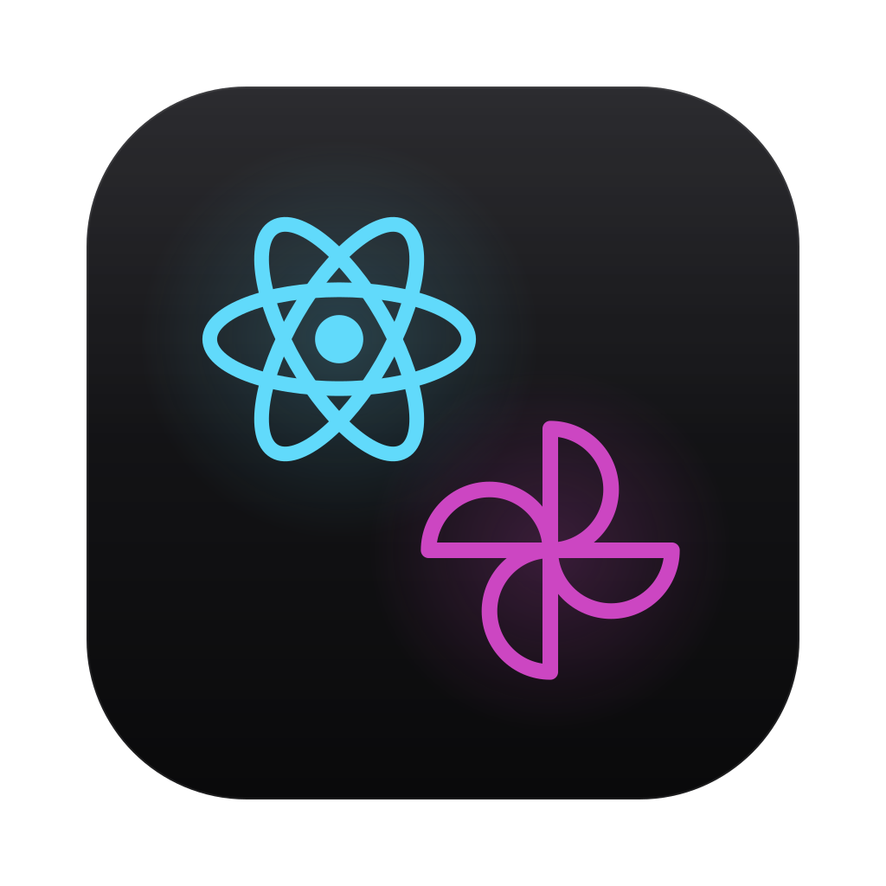

<p align="center">
  
</p>

<h1 align="center">React Native macOS · Uniwind</h1>

<p align="center">
  A slim starter for native macOS apps with React Native, styled with Uniwind (Tailwind CSS 4).
</p>

<p align="center">
  
</p>

<p align="center">
  <a href="https://microsoft.github.io/react-native-macos/"></a>
  <a href="https://react.dev"></a>
  <a href="https://uniwind.dev"></a>
  <a href="https://www.typescriptlang.org/"></a>
  <a href="https://www.npmjs.com/"></a>
</p>

<p align="center">
  
  
</p>

<br />

## ✨ What is this?

A clean starting point for a **native macOS desktop app** written in React Native. The `macos/` folder is exactly what the official `react-native-macos` template generates (a SwiftUI app shell), and Uniwind adds Tailwind CSS 4 classes on top, so `className="bg-background text-foreground"` just works and follows the system's light or dark appearance.

The sample screen only proves that the toolchain works. Replace [`src/App.tsx`](src/App.tsx) and start building. 🛠️

> ⚠️ This template targets **macOS only**. There is no iOS or Android project.

## 🚀 Included

- 🖥️ React Native macOS `0.83` with the New Architecture and the official SwiftUI app shell
- 🎨 Uniwind + Tailwind CSS 4 with semantic light/dark theme tokens
- 🧩 TypeScript 7
- 📦 npm, with the versions React Native macOS expects
- 🍎 One SVG app icon, rendered into the Xcode asset catalog
- 🚢 GitHub Actions CI: typecheck, macOS bundle and a Release build of the app

## 🧰 Tech stack

| Layer | Choice |
| --- | --- |
| UI runtime | React Native macOS `0.83` + React Native `0.83` + React `19.2` |
| Native shell | SwiftUI (`AppDelegate.swift`) from the official template |
| Styling | Uniwind `1.13` + Tailwind CSS `4` |
| Language | TypeScript `7` |
| Package manager | npm |
| Native tooling | Xcode + CocoaPods (via Bundler) |

## 📁 Project layout

```text
react-native-macos-uniwind/
├── src/
│   ├── App.tsx              # Starter screen, edit this first
│   ├── global.css           # Tailwind + Uniwind + light/dark theme tokens
│   ├── global.d.ts          # Lets TypeScript import .css files
│   └── uniwind-types.d.ts   # Generated by Uniwind
├── macos/
│   ├── App-macOS/           # AppDelegate.swift, Info.plist, entitlements, app icon
│   ├── App.xcodeproj/       # Xcode project (open App.xcworkspace)
│   └── Podfile
├── assets/icon.svg          # App icon source
├── .github/workflows/       # CI
├── app.json                 # App name (must match AppDelegate.swift)
├── index.js                 # Registers the root component
└── metro.config.js          # withUniwindConfig()
```

## ⚡ Quick start

### Prerequisites

- macOS with Xcode
- Node.js `20.19.4` or newer
- Ruby with Bundler (installs the pinned CocoaPods version)

### 1. Install dependencies

```bash
npm install
bundle install
bundle exec pod install --project-directory=macos
```

### 2. Run the app

`run-macos` doesn't start Metro for you, so use two terminals:

```bash
npm start        # terminal 1: Metro
npm run macos    # terminal 2: build and launch the app
```

## 🧑‍💻 Development scripts

| Command | Description |
| --- | --- |
| `npm start` | Start Metro |
| `npm run macos` | Build and launch the Debug app |
| `npm run macos -- --mode Release` | Build and launch a Release app with the bundled JS |
| `npm run typecheck` | Run `tsc` |

## 🎨 Start building

1. Edit [`src/App.tsx`](src/App.tsx).
2. Style with `className`. Semantic tokens (`background`, `foreground`, `muted`, `primary`, …) are defined once in [`src/global.css`](src/global.css), with light and dark variants that follow the system appearance. Add new tokens there, in both variants, instead of hardcoding colors.

```tsx
<View className="flex-1 items-center justify-center gap-4 bg-background">
	<Text className="text-3xl font-bold text-foreground">Hello, macOS 👋</Text>
	<Text className="text-muted-foreground">Same tokens in light and dark</Text>
</View>
```

The Uniwind `rem` polyfill is set to `14` in [`metro.config.js`](metro.config.js), so `text-base` matches the smaller default text size of macOS.

## 🏷️ Make it yours

| What | Where |
| --- | --- |
| Module name `App` | `app.json` (`name`) and `withModuleName:` in `macos/App-macOS/AppDelegate.swift`. They must match. |
| Window title | `Window("App", …)` in `AppDelegate.swift` |
| App name in the menu bar and Finder | `PRODUCT_NAME` of the `App-macOS` target in Xcode |
| Bundle identifier `org.reactjs.native.App` | `PRODUCT_BUNDLE_IDENTIFIER` of the `App-macOS` target in Xcode |
| Version | `CFBundleShortVersionString` in `macos/App-macOS/Info.plist` |

**Icon:** edit [`assets/icon.svg`](assets/icon.svg), then render it into the asset catalog:

```bash
npx @tauri-apps/cli icon assets/icon.svg -p 16,32,64,128,256,512,1024 -o /tmp/app-icon
dir=macos/App-macOS/Assets.xcassets/AppIcon.appiconset
for s in 16 32 128 256 512; do
	cp /tmp/app-icon/${s}x${s}.png $dir/AppIcon-$s.png
	cp /tmp/app-icon/$((s * 2))x$((s * 2)).png $dir/AppIcon-$s@2x.png
done
```

## ⬆️ Upgrading

`react-native-macos` decides which React Native you can use. Its peer dependency names the exact `react-native` version:

```bash
npm view react-native-macos peerDependencies
```

Bump `react-native-macos`, `react-native` and the `@react-native/*` packages together. Set `react` to the version that React Native's own template uses, since the renderer requires an exact match. Then compare `macos/` with the upstream template in `node_modules/react-native-macos/local-cli/generator-macos/templates` and run `bundle exec pod install --project-directory=macos`.

`metro` and `metro-cache` are pinned to the Metro line that React Native uses. Uniwind declares them as `*` peer dependencies, so without the pins npm installs the newest Metro next to the one the CLI runs, and bundling fails. Move them to the Metro minor that `npm ls metro` reports under `react-native`.

## 🧩 Optional tooling

Intentionally not included. Pick what you like:

- **Lint + format:** [Biome](https://biomejs.dev) or [oxlint](https://oxc.rs/docs/guide/usage/linter) + [oxfmt](https://oxc.rs/docs/guide/usage/formatter).
- **Tests:** Jest, set up as in the [official React Native template](https://github.com/react-native-community/template).

CI ([`.github/workflows/ci.yml`](.github/workflows/ci.yml)) runs the typecheck, a production macOS bundle and an unsigned Release build of the app.

## 🩹 Troubleshooting

If the app shows a red screen about the development server, Metro isn't running. Start it with `npm start`.

If Metro is already running on port `8081`, stop the other process first.

If bundling fails with `Unexpected module with full source map found`, two Metro versions are installed. `npm ls metro metro-cache` should show a single version. After fixing that, restart Metro with `npm start -- --reset-cache`.

After adding a dependency with native code, run `bundle exec pod install --project-directory=macos` again. If CocoaPods fails while fetching a pod, run it once more.
